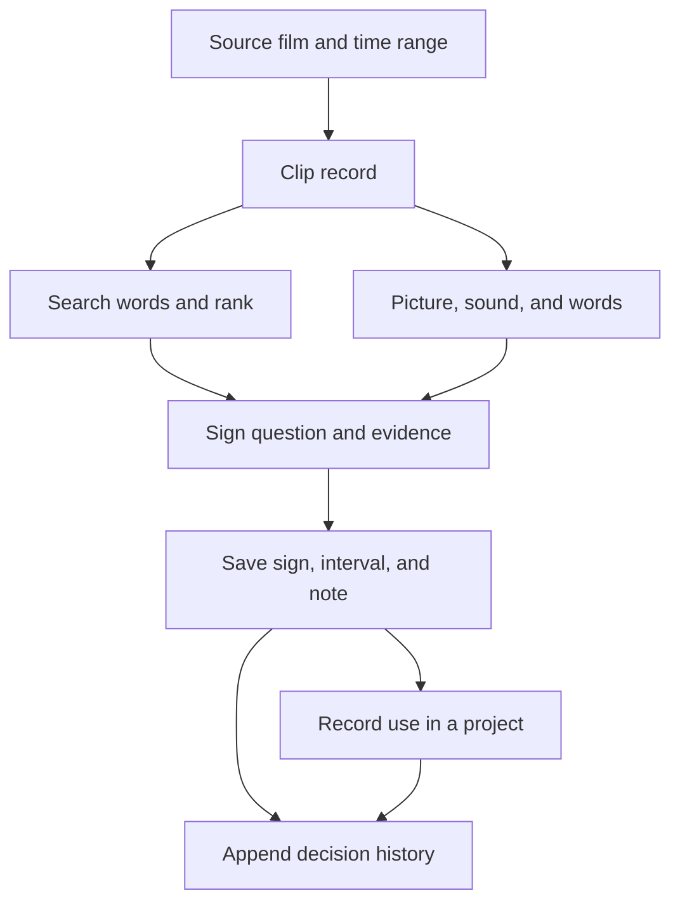

# Operating with signs

Select a shot. Play its interval. Read its recorded search, caption, sound labels, transcript, reading, and source. Test a sign question against those records. Save the sign, interval, and evidence. Place the interval in a project. Follow the recorded use back to its source.

## Operational diagnostic

- Replace similarity alone with the selected measure: picture, sound, words, colour, or sign affinity.
- Replace classified with retrieved by a sign search, machine candidate, editorial reading recorded, or saved sub-shot assignment.
- Replace included with a destination film and recorded use. Keep inclusion separate from reading.
- Replace claims about what a user understands with a visible question, playback action, evidence record, or saved decision.

## Control surface

In Axes, switch Hide filtered-out shots on to remove shots outside the current filter from cells and hit targets. Switch it off to restore their context. Read matching, dimmed, and hidden counts. Keep axes and camera unchanged when toggling. Press fit to fit the layout.

Select a sign and read Test this sign. Replay the cited interval. Read the editorial note, context confidence, shot-only confidence, and alternative separately. Treat machine affinity as a relative score, not an editorial decision or a calibrated probability.

For an unread shot, read No editorial reading recorded. If a machine candidate exists, test its question. Do not convert a candidate into a reading merely because it ranks first.

Set A and B. Choose the sign. Write what the interval shows and the condition under which another sign would apply. Save the sub-shot. On the static site, export browser assignments to retain them outside that browser.

Open How this clip was made and read. Inspect source bounds, retrieval records, coordinates, affinities, read-frame time, saved assignments, and downstream uses. A missing field establishes missing recorded evidence, not a failed or unperformed operation.

Press Leave close-up or Escape to stop inline players and return to the fitted map. Close the inspector before changing map views. Preserve filters when returning.

## Current build: why some shots have no reading

`build_lab.py` assembles the corpus and optional analysis caches. It builds editorial readings from each sign's examples in `cineosis-table.json`. It builds retrieval records separately from `results/*.json`. A retrieved or embedded shot can therefore lack an editorial reading. The absence does not record rejection.

`app.js` loads downstream uses from `provenance.json`, transcript text from `transcripts.json`, and timed words from `words.json`. Keep sound labels separate from spoken words. Local assignments are separate from published editorial examples.

## Clip operations and records

This diagram specifies operations and records. It does not claim every clip completed every branch.

## Required history extension

Append an event for each import, extraction, embedding, transcription, reading, revision, assignment, and project use. Record event ID, clip ID, operation, time, actor/model, model version, inputs and hashes, prompt/configuration, outputs, status, and superseded event where applicable. Keep source time, clip time, and destination time distinct.

Label unavailable history Not recorded. Do not manufacture processing dates from file modification times or infer model versions from coordinates. Existing records support a current-state trace; they do not yet establish a complete history of model runs and editorial decisions.

## Verification

- Hide/show filtered shots; confirm hidden shots cannot be selected.
- Change filters while hiding; confirm cell counts update.
- Preserve live remote results without duplicating corpus hits.
- Confirm picture mode retains existing filter context.
- Exit a close-up during animation; confirm stopped players do not restart.
- Test mobile and desktop rendering and keyboard access before merging.

